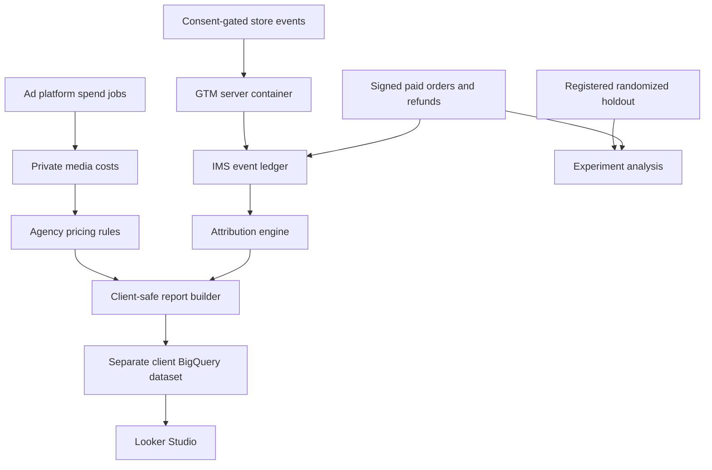

# System design

## Business objective

One IMS-managed measurement service per agency, multiple isolated clients, reusable tracking installation, defensible revenue attribution and separately measured incremental lift. Publish client-facing performance into Looker Studio without exposing vendor media costs or pricing rules. Do not train AI to invent causal lift or treat a view-through claim as verified incremental revenue.

## Topology

The experiment diagram connection represents normalized outcome data. The current code requires explicit experiment-outcome ingestion; it does not automatically assign every order to an experiment.

## Recommended low-cost deployment

- Pilot: one small Linux VM, Docker/Gunicorn, encrypted durable disk with SQLite WAL, TLS reverse proxy, periodic backups, one job runner; Google-managed or specialist-hosted server GTM.
- Reporting: BigQuery per-client dataset containing only safe aggregate outputs; Looker Studio native BigQuery connection. No proprietary paid connector required for that route.
- Automation: systemd timers/cron on the pilot VM with file locks. Failures alert the operator. Google OAuth token refresh supported in spend job; Meta system-user token lifecycle and API permissions require account setup.
- Scale: move operational storage to PostgreSQL, add a durable queue, separate collectors from jobs, partition event storage, stream/batch events to warehouse. The present SQLite implementation is deliberately single-host; it must not be deployed on ephemeral Cloud Run disk or replicated across instances.

## Event and identity rules

Merchant-specific consent must authorize analytics before a first-party pseudonymous visitor is created. Advertising forwarding additionally requires explicit marketing permission. The app does not circumvent consent, browser restrictions, blockers or Shopify sandbox isolation.

Persisted browser payload is limited to event ID, pseudonymous visitor ID, timestamp, channel, campaign, medium, optional order observation and separately consented allowlisted click/cookie identifiers. No email, full URL, raw IP, phone or arbitrary query string is stored. CTV network keys use a separate per-tenant HMAC flow described in CTV.md. Shopify customer IDs are merchant-secret HMAC pseudonyms. Browser identity expires after 30 days. Consent withdrawal clears local identity; production must add authenticated server-side erasure/consent propagation workflows.

Known customer ID and visitor ID are separate concepts. The code does not probabilistically merge people, stitch cross-device journeys or infer identity from IP. Anonymous orders remain unattributed when no deterministic link exists. Browser observations are untrusted telemetry; origin checks are not authentication or bot prevention. WAF rate limits and integrity monitoring are required.

## Revenue definition

Signed Shopify `orders/paid` creates one order keyed by tenant + normalized Shopify order ID. Revenue is shop-currency discounted merchandise subtotal, excluding tax and shipping. Merchandise refunds subtract line subtotals and restate the original order date. Retried webhook and order IDs are idempotent; conflicting imports fail rather than overwrite silently. Refunds can arrive before the order.

Amounts use integer minor units. v1 supports USD, CAD, EUR, GBP, AUD and NZD, one currency per tenant. No FX conversions or JPY/KWD assumptions. Reporting uses tenant timezone; spend source timezone must match. API fetchers report account calendar days; reject or normalize mismatched account timezones before ingestion. Cross-channel revenue never comes from summing vendors' self-reported sales.

Test orders are excluded. The supplied Shopify GraphQL sync/backfill obtains authoritative currentSubtotalPriceSet snapshots for paid/refunded orders; included historical refunds are not subtracted twice, while later refunds restate the snapshot until the next sync. Live order edits, cancellation/payment edge cases, tax-inclusive settings and non-merchandise adjustments must be validated in the merchant acceptance tests. Reporting dates remain original order dates.

## Attribution

Assign credit to recorded touches within configured lookback, never after order timestamp. Direct touches do not displace a known non-direct journey. If no journey exists, classify as unattributed rather than manufacture a source.

- First touch: first recorded non-direct touch within lookback.
- Last touch: last recorded non-direct touch within lookback.
- Linear: equal credit per recorded touch, not per distinct channel.
- Position based: 40% first, 40% last, 20% split across middle touches; two touches split equally.

All four models conserve order and revenue credit (subject to presentation rounding). Spend is not multiplied across attribution models. Publish each model to a separate table or require a model filter. Do not sum multiple model tables together. Campaign keys must use stable platform campaign IDs in UTMs; campaign names and IDs cannot be joined interchangeably. `(unmapped)` has no false campaign-level ROAS match.

## Agency pricing and client boundaries

`billable cost = vendor cost × (1 + markup percentage)` rounded per daily campaign row. 100% markup doubles cost; it is not a 100% profit margin. A 50% gross margin is equivalent to 100% markup.

Specific-channel rule overrides default wildcard; latest effective date applies within that rule. Historical markup changes intentionally restate client reports and are audit logged. Lock invoiced periods in a production billing integration if required.

Client ROAS = net attributed revenue / billable media cost. CPA = billable media cost / attributed orders. CPC = billable media cost / clicks. CPM = billable media cost / impressions × 1,000. CTR does not change with markup. Null denominators remain null. `orders_per_click` is explicitly not website session conversion rate. Aggregate ratios must be recomputed from totals in Looker Studio; never average row-level ROAS/CPA/CPC/CPM.

Raw media cost, margin, rate rules and audit data live only in agency storage/API. Client API derives tenant from credential and uses a safe serializer; BigQuery export has a strict field allowlist. Use a separate client dataset and narrowly scoped reporting service account. Hiding fields in a chart is insufficient. Clients must have no raw dataset, agency credential, SQL access, dashboard edit access to agency sources, or vendor-cost connector. Clients who independently have ad-account billing access can still see those vendors' costs; software cannot hide information they already control. Client-facing cost definitions should match the agency's commercial agreement.

## Incrementality

Register a hypothesis, fixed start/end, randomization unit, allocation fraction and minimum sample count before enrolling units. Code assigns units using a secret salted HMAC, freezes assignment and requires enrollment before campaign start. Campaign operators must exclude control units and target treatment units in the relevant buying platforms. Assignment is not exposure, suppression or a DSP integration.

Import all eligible pre-enrolled units, including those with zero purchases. Outcomes must come from an independent complete source and fall inside the window. Analyze by intention to treat, not only exposed users, clickers or visitors. Website-only randomization cannot measure acquisition lift for people who never visited.

For randomized customer tests, use customers as independent units. For randomized geo tests, aggregate outcomes per entire geography and resample whole geographies. Geo conversion rate in v1 means share of geographies with an outcome, not a customer conversion rate. No automatic matched-market, synthetic-control or observational causal claim is implemented. Small geography counts may be underpowered and require specialist design outside v1.

Output: revenue per unit, absolute/relative lift, treatment-population incremental revenue, unit bootstrap interval, two-sided Monte Carlo permutation p, sample-ratio check, observed purchaser-rate difference and iROAS. Revenue is the sole inferential endpoint in v1; purchaser-rate difference is descriptive. Incremental media cost is explicitly supplied using the desired billable-cost basis; do not accidentally feed vendor cost to a client report. Experiments remain agency-only until reviewed aggregates are published.

Fixed-horizon analysis must not be used for repeated-peeking stopping decisions. Sample minimum is an operational guard, not a power calculation. Before launch estimate MDE/power, specify exclusions, contamination/spillover handling, refund horizon and multiple-test correction. The software does not prove that IMS's operational incrementality process was correctly followed.
